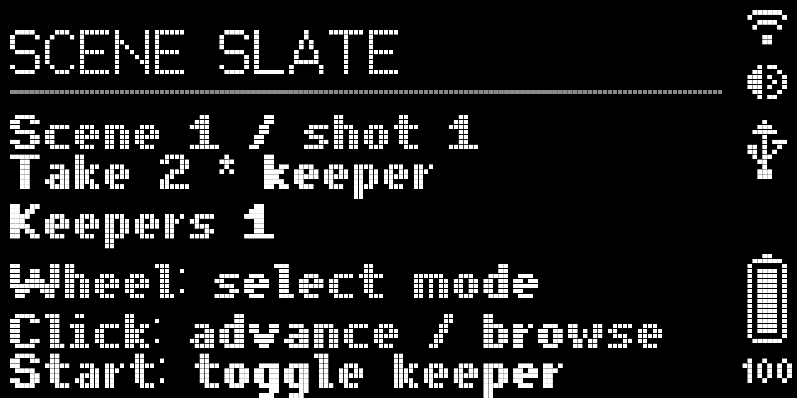
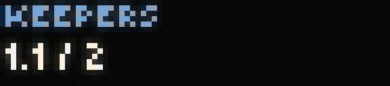

# Scene Slate

Slate scene and shot numbers, advance takes, and mark keepers for the editor.

Use the front display as a small slate between takes. The person logging the shoot can read the same take number as the camera operator and flag a keeper while the scene is still fresh.

## Screen transitions

Follow the slate as you mark a take and move on to the next setup.


<details>

<summary>Watch the rear display</summary>



</details>

## Mark a take for the editor

1. In **Take**, read the active take number before rolling. The rear display identifies the scene and shot.
2. After a take worth keeping, press **Start** before advancing. The rear display adds an asterisk to the take. Turn the wheel to **Keepers** to read the saved label.
3. If you flagged the active take by mistake, press **Start** again to remove it. The clip shows the last saved entry being removed.



## Move to the next setup

1. Hold the wheel to return to **Take** from any view. Click to advance just the take number.
2. Turn to **Shot** and click when the camera moves to a new setup. The shot advances and its take count starts at one.
3. For a scene change, turn to **Scene** and click. Both shot and take start again at one. In the recording the wheel browses the counters before changing any of them.


## Read a keeper label

A label such as `3.2 / 4` means scene three, shot two, take four. You can mark more than one take in a shot. In **Keepers**, click to step through the stored entries. The app keeps the latest 50 marks. Pressing **Start** always toggles the active slate, including while you are reading a different saved entry.

If a take needs another try with the camera in the same spot, stay in **Take**. Advancing **Shot** would give the next attempt a different shot number in your notes.

## Run in the emulator

Open BUSY Bar Emulator. From this repository, run:

```sh
~/.busy-emulator/bin/busy-emulator dev --once
```

Press **Back** to exit.

The GIFs are excerpts from the emulator recording. Each LED occupies a 16 × 16 cell with a black border. The end frames pause for reading.

[Full recording](media/controls.mp4) · [Rear display](screenshots/back-1.png) · [Firmware test](EMULATOR-QA.md) · [MIT license](LICENSE)
